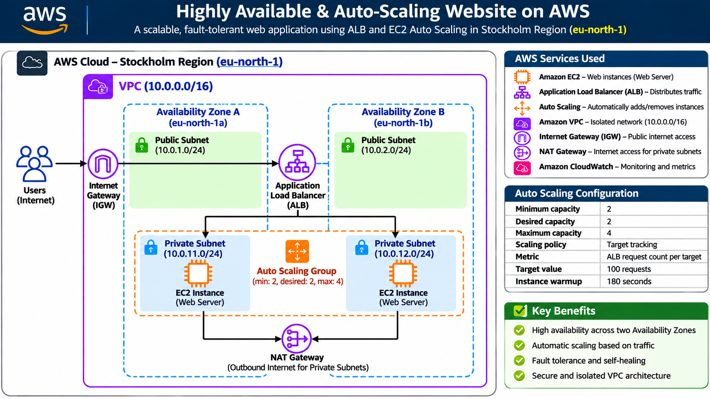

 Highly Available & Auto-Scaling Website on AWS

Project Overview

This project demonstrates how to deploy a highly available web application using AWS infrastructure. It uses an Application Load Balancer and an EC2 Auto Scaling Group to distribute incoming traffic and maintain application availability.

 AWS Services Used

- Amazon VPC
- Amazon EC2
- Application Load Balancer (ALB)
- EC2 Auto Scaling
- Amazon VPC NAT Gateway
- Internet Gateway
- Security Groups
- Amazon CloudWatch
- AWS CloudShell

Architecture

The infrastructure is deployed in the AWS Stockholm region (`eu-north-1`).

- One custom VPC (`10.0.0.0/16`)
- Two public subnets across two Availability Zones
- Two private subnets across two Availability Zones
- Internet Gateway for public connectivity
- NAT Gateway for private subnet outbound connectivity
- Application Load Balancer in public subnets
- EC2 instances in private subnets
- Auto Scaling Group with minimum 2 and maximum 4 instances
- Target tracking scaling policy using ALB request count per target (100)

Website Features

The website displays:

- Personal portfolio information
- Cloud and DevOps skills
- GitHub profile
- EC2 instance hostname
- Availability Zone information

The hostname and Availability Zone help demonstrate traffic distribution across instances.

High Availability Testing

The following tests were performed:

1. Accessed the website through the ALB DNS endpoint.
2. Verified healthy EC2 targets in the Target Group.
3. Terminated an EC2 instance and verified that Auto Scaling launched a replacement.
4. Manually increased desired capacity from 2 to 3 and verified a new instance launch.
5. Reduced desired capacity back to 2.
6. Sent 500 HTTP requests using AWS CloudShell.

Note: The CloudShell load test completed, but an automatic scale-out triggered by that test was not confirmed.

Auto Scaling Configuration

| Setting | Value |
|---|---|
| Minimum capacity | 2 |
| Desired capacity | 2 |
| Maximum capacity | 4 |
| Scaling policy | Target tracking |
| Metric | ALB request count per target |
| Target value | 100 |
| Instance warmup | 180 seconds |

 Project Status

The VPC, networking, EC2, ALB, Target Group, and Auto Scaling infrastructure were configured and tested.

Custom domain and HTTPS configuration using Route 53 and ACM were not completed because a domain name was unavailable.

Project Screenshots

All AWS implementation screenshots are available in the [screenshots](./screenshots/) folder.

Architecture Diagram

Author

Umar Farooq

GitHub: https://github.com/Farooq-dev00

Project: AWS Highly Available Website
